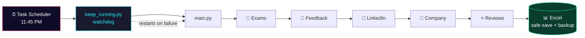

<!-- Created by YOGESHWARAN TL -->
<div align="center">


<br/>


</div>

```text
                 ____    _____   ____    _   _      _      _____
                |  _ \  | ____| |  _ \  | | | |    / \    |_   _|
                | |_) | |  _|   | | | | | |_| |   / _ \     | |
                |  _ <  | |___  | |_| | |  _  |  / ___ \    | |
                |_| \_\ |_____| |____/  |_| |_| /_/   \_\   |_|

    _      _   _   _____    ___    __  __      _      _____   ___    ___    _   _
   / \    | | | | |_   _|  / _ \  |  \/  |    / \    |_   _| |_ _|  / _ \  | \ | |
  / _ \   | | | |   | |   | | | | | |\/| |   / _ \     | |    | |  | | | | |  \| |
 / ___ \  | |_| |   | |   | |_| | | |  | |  / ___ \    | |    | |  | |_| | | |\  |
/_/   \_\  \___/    |_|    \___/  |_|  |_| /_/   \_\   |_|   |___|  \___/  |_| \_|
                                                      >> by YOGESHWARAN TL  v0.1
```

## 🧠 What it does

One program fills the **Red Hat exam Excel workbook for a whole day**, without anyone typing data in by hand. It drives Chrome, a Windows desktop app and Excel step by step, and it runs on its own every night.

| # | Step | Source ➜ Excel |
|:-:|------|----------------|
| 1 | 🎯 **Exams** | Red Hat Exam Scheduler (Completed + Scheduled, per location) ➜ new rows + kiosk count table. The **Adv Pro** desktop app checks "Our Student" by phone number |
| 2 | 📝 **Feedback** | Feedback Google Sheet ➜ company, designation, feedback, remark |
| 3 | 🔗 **LinkedIn** | Outlook contact card ➜ LinkedIn URL, with a Google search fallback and strict name/company matching |
| 4 | 🏢 **Company** | LinkedIn profile ➜ current company + role |
| 5 | ⭐ **Reviews** | Google Maps reviews (last 24 h) ➜ `Google Review` = **Y** + remark. **Only real reviews** |



## 🛡️ Built-in safety ("cyber" mode)

- 🔐 **Secure vault.** `lock.bat` encrypts the source into `vault\` and leaves only `.pyc` files, with a 3-try lockout. `unlock.bat` brings the source back.
- 💾 **Never loses data.** Every save makes a backup first and goes through a temp file + replace.
- 🔁 **Self-healing.** `keep_running.py` restarts the program until every step is finished, resumes from `logs\progress_<date>.json`, and catches up on unfinished steps from the last 7 days.
- 🧭 **Strict matching.** LinkedIn/Google results are kept only when the name **and** company (or location) match, so wrong people are rejected.
- 🖥️ **Live view.** `show_status.bat` opens a window that follows the hidden nightly run.
- 🩺 **Repair tool.** `Repair\Repair.bat` stops stuck runs, cleans locks, reinstalls packages and checks everything.

## ⚙️ Setup

1. Install **Python 3.11+** and **Google Chrome**.
2. Install the packages:
   ```bat
   pip install -r requirements.txt
   ```
3. Open `config.ini` and fill in your own values:
   | Section | What to set |
   |---|---|
   | `[excel]` | Path to your Red Hat Excel workbook |
   | `[chrome]` | Path to `chrome.exe`, debug port (default `9222`) |
   | `[redhat]` | Scheduler URL, Chrome shortcut, time zone, location IDs |
   | `[feedback]` | Feedback Google Sheet link + Chrome shortcut |
   | `[linkedin]` | Outlook Chrome shortcut, Google fallback options |
   | `[advpro]` | Path + login of the Adv Pro desktop app |
   | `[review]` | Google Maps link of the business |
   | `[catchup]` | How many earlier days to check (default `7`) |
4. Close every Chrome window once, so the program can start Chrome with the control port.

> ⚠️ **Never upload `config.ini`, Excel files, `backups\`, `logs\`, `reports\` or Chrome profiles to GitHub.** They contain passwords and personal data.

## 🚀 How to use

| Want to… | Do this |
|---|---|
| Run everything for a day | Double-click **`run_all.bat`** (asks for the date, Enter = today) |
| Run one step only | `run.bat` (exams) · `run_feedback.bat` · `run_linkedin.bat` · `run_company.bat` · `run_reviews.bat` |
| Watch the nightly run | **`show_status.bat`** |
| Stop the automation | **`stop.bat`** |
| Fix problems | **`Repair\Repair.bat`** |

Command line:

```bat
python main.py                       :: asks for the date
python main.py --date 2026-11-19     :: a specific day
python main.py --skip-linkedin       :: leave out a step (--skip-exams/-feedback/-company/-reviews)
python main.py --skip-advpro         :: no "Our Student" check
python main.py --dry-run             :: test run, nothing is saved
```

### 🌙 Nightly (automatic)
Task Scheduler task **"RedHat Nightly 1140PM"** runs `run_hidden.vbs` ➜ `run_nightly.bat` ➜ `keep_running.py --nightly` at **11:45 PM**, then every 10 minutes until morning. Results are in `logs\keep_running.txt`. When the day is done you'll see *"Finished: the Excel file is complete"*.

## 📁 Files

```text
main.py                  the 5 steps, in order
redhat_automation.py     Exam Scheduler + Adv Pro + Excel
feedback_from_sheet.py   feedback Google Sheet
linkedin_from_outlook.py Outlook -> LinkedIn (+ Google fallback)
company_from_linkedin.py LinkedIn profile -> company / role
google_reviews.py        Google Maps reviews
keep_running.py          watchdog / restart / nightly
live_view.py             live status window
secure_vault.py          lock / unlock
Repair\                  repair tool
```

<div align="center">

## 👨‍💻 Created by

<a href="https://github.com/yogeshwaran2912"></a>

**Yogeshwaran** · *Turning exam-centre paperwork into code* ⚡


</div>
